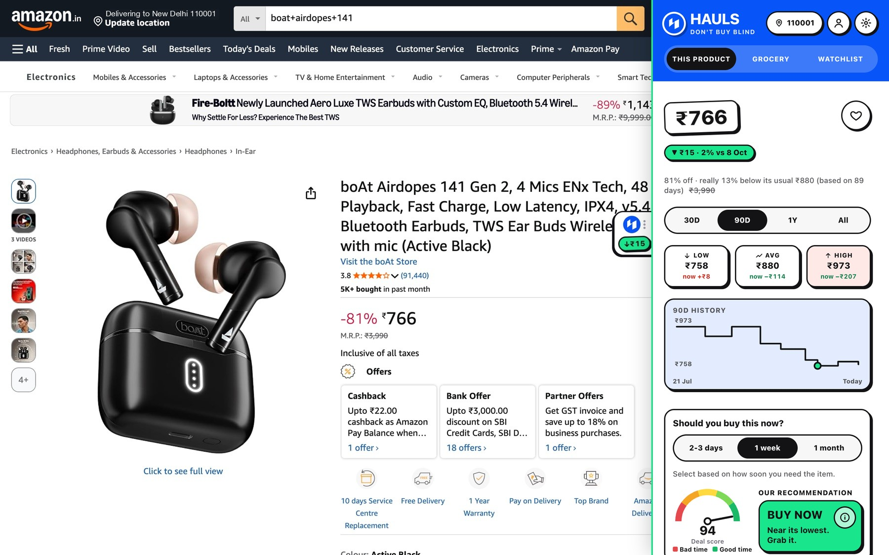
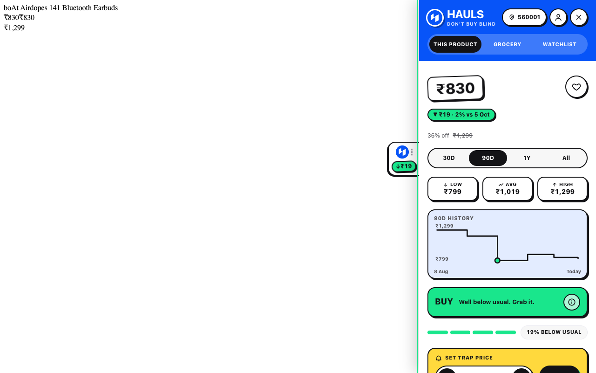
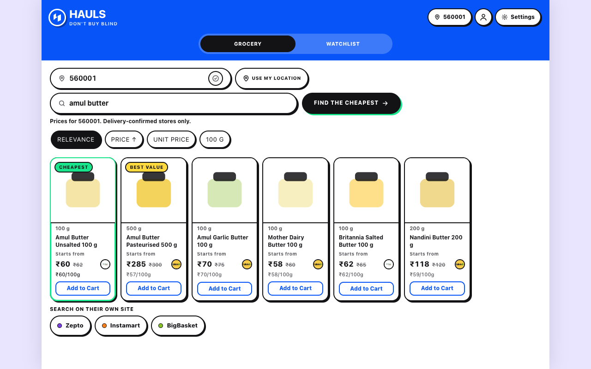
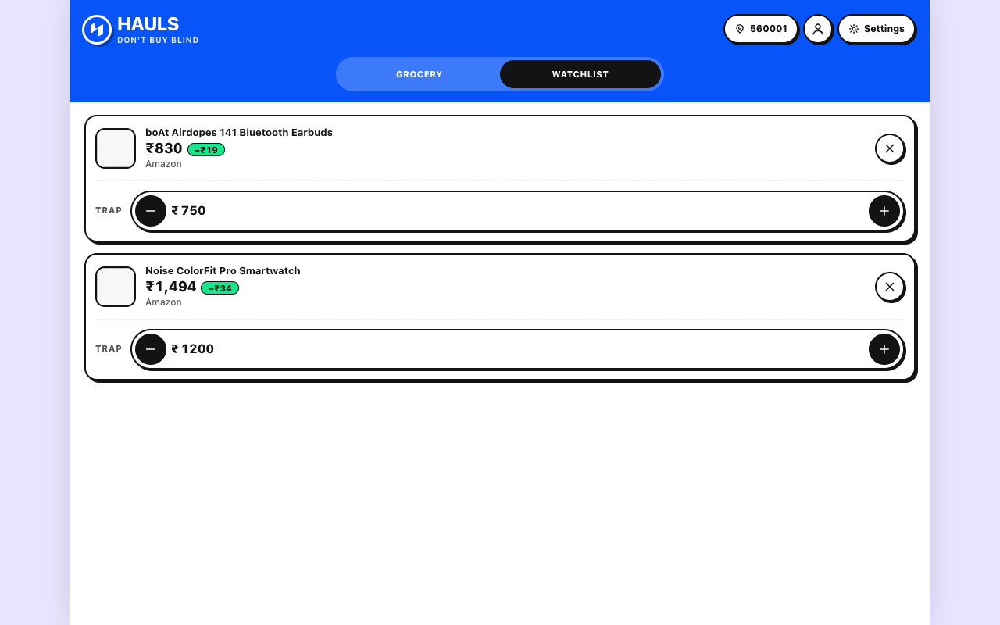
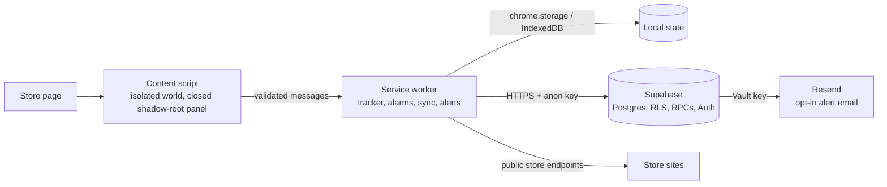

<p align="center"></p>

<h1 align="center">HAULS</h1>
<p align="center"><b>Don't buy blind.</b><br>A free browser extension that shows real price history and a plain buy-or-wait answer on Indian shopping sites.</p>

<p align="center">
  <a href="../../releases/latest"></a>
  <a href="../../actions/workflows/security.yml"></a>
  
  
</p>
<p align="center">
  <a href="https://kumarvishwajeettrivedi.github.io/Hauls_Chrome_Extension/">Website</a> ·
  <a href="../../releases/latest/download/hauls-share.zip">Download</a> ·
  <a href="INSTALL.md">Install guide</a> ·
  <a href="SECURITY.md">Security</a> ·
  <a href="https://hauls.in/">hauls.in</a>
</p>

<p align="center"></p>

## Overview

Open a product on Amazon.in, Flipkart or Myntra and HAULS adds a small tab to the right edge of the page. Click it to see how the price has moved, whether the "discount" is real, who else sells the item and for how much, and whether to buy now or wait. Click the toolbar icon to open or close the same panel.

You do not need an account. Signing in with Google is optional and only adds sync across devices and email alerts.

| Price history and verdict | Grocery comparison | Watchlist |
|---|---|---|
|  |  |  |

## Features

- **Price history.** Lowest, average and highest price over 30 days, 90 days, a year or all time.
- **Buy-or-wait verdict.** A plain answer with the reason. You can say how soon you need the item (2-3 days, 1 week, 1 month), which changes the call for fair prices and suggests an alert price.
- **Deal Scanner.** A 0-100 score with the points behind it, and a warning when a price was raised shortly before a "discount".
- **Impulse Check.** Notices "Only 2 left" labels, countdown timers and sale banners, remembers them across your visits, and shows what changed: did the timer restart, is the count the same, did the price move. It reports observations and does not label a message fake.
- **Seller intelligence.** Reviews (the page's own average and rating split) and a seller card built from the seller's public storefront: rating windows, share of positive ratings, volume and recent trend.
- **Other sellers.** On Amazon and Flipkart, every seller's price for the same item with the lowest marked. On Myntra, the sellers listed on the page with a price per size.
- **Same-product compare.** Compares Amazon, Flipkart and Reliance Digital and lists only results it can confirm are the same item (brand, model, version, storage and size are checked). The closest rejected result is shown with the reason.
- **Grocery comparison.** Search once and compare quick-commerce stores at your pincode. A store shows a price only if it confirms delivery to that pincode.
- **Price alerts.** Set the price you want and get a browser notification when it is reached. Optional email alerts after you sign in. Alerts and background checks run while the browser is open.
- **Watchlist.** Each account has its own watchlist on a computer. Signing out and in again with the same account brings the items back.
- **Amazon's own price graph.** When Amazon draws its "Price history" chart, HAULS reads the chart data, merges it with its own history and shows lowest/highest prices. An opt-in setting can read it automatically in the background.

## Supported stores

| Kind | Stores |
|---|---|
| Full support | Amazon.in, Flipkart, Myntra |
| Price tracking | Croma, Reliance Digital, Tata CLiQ, Nykaa, Vijay Sales, Snapdeal |
| Grocery comparison | Blinkit and DMart by default; JioMart, BigBasket and Zepto only when you ask for more stores |
| Independent (Shopify) stores | Opt-in: you grant access from Settings; nothing broad is granted by default |

Runs in Chrome, Edge, Brave and other Chromium browsers on a computer. Phones are not supported. Store sites change; Settings shows per-store health, and a remote switch can pause a store that breaks.

## Privacy

- **Stays on your device.** Browsing history of prices, the Impulse Check memory and your settings are stored in your browser first.
- **Syncs only if you sign in.** Watchlist, saved places and settings are backed up to your own account and visible only to you (row-level security in the database).
- **Shared only if you opt in.** Contributing anonymous prices and Amazon chart data is off by default. Shared data is kept apart from your name and email and shown only as combined history once at least 3 different contributors have reported the product. You can remove what you shared from Settings.
- **Deletion.** Items you delete from your watchlist are blanked on the server immediately (only a key-only marker stays so your other devices learn about the deletion). The marker is purged within 24 hours of your account's next sync or sign-in, or by the server-side purge function (`ext_purge_old_data`, which covers these markers from migration 0018 and runs only if the maintainer schedules it). An account that never returns and has no scheduled purge keeps the marker. You can export or delete your cloud data from the account menu in the panel.
- **No selling.** HAULS does not sell or rent data and has no ads or trackers.
- **Account separation.** Each account's data is kept apart, on the server and in the extension.

## Security

The extension ships no remote code, no `eval`, a strict extension-page CSP, a narrow permission set and only the public Supabase anon key; all data access is enforced by row-level security. Messages between content scripts and the service worker are validated, and scraped text is only ever inserted as text and is size-bounded.

- [SECURITY.md](SECURITY.md): how to report a vulnerability.
- [docs/threat-model.md](docs/threat-model.md): assets, attackers, abuse paths and mitigations.
- [docs/security.md](docs/security.md): extension security model with the test that proves each mitigation.

**Reporting.** Please report vulnerabilities through a private security advisory on this repository, not a public issue. Response targets and scope are in [SECURITY.md](SECURITY.md).

## Install

1. Download `hauls-share.zip` and `SHA256SUMS.txt` from the [latest release](../../releases/latest).
2. Verify the download (the output must match the `hauls-share.zip` line in `SHA256SUMS.txt`):
   ```bash
   shasum -a 256 hauls-share.zip        # macOS / Linux with shasum
   sha256sum hauls-share.zip            # Linux
   certutil -hashfile hauls-share.zip SHA256   # Windows
   ```
3. Unzip into a folder you will keep, open `chrome://extensions`, turn on Developer mode, choose **Load unpacked**, and select the folder that contains `manifest.json`.

Step-by-step instructions for each browser: [INSTALL.md](INSTALL.md). Official sources are this repository, the [project website](https://kumarvishwajeettrivedi.github.io/Hauls_Chrome_Extension/) and the [releases](../../releases); copies elsewhere are not published by the author.

## Architecture



```
extension/            Manifest V3 extension (no build step, no runtime dependencies)
supabase/migrations/  database schema, policies and functions, applied in order
tests/                unit, SQL (PGlite), integration, live-check and end-to-end tests
scripts/              config generation, packaging, provenance
docs/                 sign-in setup, auth/state architecture, security, threat model
site/                 project website (GitHub Pages)
```

The page never talks to the backend. The service worker is the only component that holds the session and calls Supabase, and it accepts only messages that pass the schema check in `extension/guard.js`.

## Development

Requirements: Node 20 or newer.

```bash
npm install
cp .env.example .env     # fill in Supabase URL and anon key; never commit .env
npm run build:config     # writes the git-ignored extension/config.js (accepts only a JWT with role anon or an sb_publishable_ key; refuses anything else)
```

Load `extension/` as an unpacked extension.

| Command | What it does |
|---|---|
| `npm run test:unit` | Unit tests (also the default for `npm test`) |
| `npm run test:sql` | Applies every migration to an in-memory Postgres (PGlite) and checks policies and functions |
| `npm run test:integration` | Checks against the real Supabase project; needs `SUPABASE_URL`, `SUPABASE_ANON_KEY` and a service-role key in `.env`; creates and deletes throwaway users |
| `npm run test:e2e` | Real Chrome with the extension against live shops; set `CHROME` to a Chrome for Testing binary if the default path is missing |
| `npm run test:stop` | Stops a running e2e job and clears its lock |
| `npm run verify:live-0010` (`-0011`, `-0012`) | Post-migration checks against the live project |
| `node tests/live/verify-0017.mjs` | Post-migration check for 0017 against the live project; creates one throwaway user and one feedback row and removes them |
| `npm run package` / `npm run package:share` | Builds the store zip / the GitHub release zip and `SHA256SUMS.txt` in `dist/`; fails if secret-looking strings are inside |

Run the e2e suite on its own: it opens a real browser window and uses the network. Contributions are welcome as issues first; read [NOTICE](NOTICE) for what is permitted.

## Backend setup (contributors)

The project shares a Supabase project with the website; everything for the extension is prefixed `ext_`.

1. In the Supabase SQL editor, run `supabase/migrations/0001` to `0018` one at a time, in numeric order. Never edit an applied migration; add a new numbered file. On a project that already has them applied, run only the newer files. **Never replay an older migration** on a live project: several functions are redefined by later files, so re-running an earlier file (for example 0015) silently restores the older, weaker version of that function until the later migration is run again. If you did, run 0017 and then 0018 again (0018 last). 0017 and 0018 are safe to re-run on their own.
2. Enable the Google provider and add the extension redirect URL: [docs/google-signin-setup.md](docs/google-signin-setup.md).
3. Email alerts: store the Resend API key in Supabase Vault from the SQL editor (see the header of `0014_ext_price_alert_email.sql`). The key lives only in Vault, never in the repository, the extension or `.env.example`.
4. Remote config: the `ext_remote_config` table (key `flags`) can switch stores and some features off (`disabled_stores`, `disabled_features`). The seeded `min_version` value is not read by the extension today. The table is public-read, service-role-write and carries data only, never code.
5. Only the public anon key goes into the extension. Keep the service-role key out of the repository and out of chat, issues and logs.

More detail: [supabase/README.md](supabase/README.md).

## License and attribution

All rights reserved; see [NOTICE](NOTICE). The code is public for transparency. Using the published extension for your own shopping is permitted; copying or republishing it is not without the author's written permission. To cite this project use the "Cite this repository" button on GitHub ([CITATION.cff](CITATION.cff)).

HAULS is designed and built by [Vishwajeet](https://github.com/kumarvishwajeettrivedi). It is an independent tool, not affiliated with any store it works with. Prices come from the pages you visit and from public store endpoints, and may differ at checkout.
