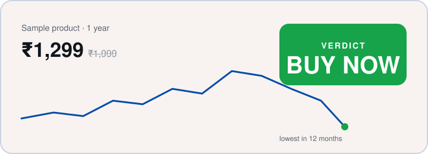

<h1 align="center">HAULS</h1>

<b>Don't buy blind.</b> A free browser extension that shows the real price history and a plain buy-or-wait answer on Indian shopping sites.

  
  

  <a href="https://kumarvishwajeettrivedi.github.io/Hauls_Chrome_Extension/">Website</a> ·
  <a href="../../releases/latest/download/hauls-share.zip">Download</a> ·
  <a href="INSTALL.md">Install guide</a> ·
  <a href="SECURITY.md">Security</a>

## The problem

"**70% OFF**" on a price that was **raised last week**. "**Only 2 left!**" with a countdown that resets on refresh. Indian shopping sites are loud. HAULS is the quiet friend who checks.

## One click, one answer

<table>
<tr><td width="33%"><h3>📈 Real history</h3>30 days to all time, so you see what the price actually did.</td>
<td width="33%"><h3>🟢 Buy or wait</h3>A plain verdict, tuned to how soon you need it.</td>
<td width="33%"><h3>🕵️ Fake-deal radar</h3>Flags prices hiked just before a "sale".</td></tr>
<tr><td><h3>🧘 Impulse check</h3>Calls out fake scarcity and countdown timers.</td>
<td><h3>🔀 Cross-store compare</h3>Only exact same-product matches. No lookalikes.</td>
<td><h3>🔔 Price alerts</h3>Set a target, get pinged when it hits.</td></tr>
<tr><td><h3>🏪 Seller check</h3>Who is really selling, and who else has it.</td>
<td><h3>🥦 Grocery prices</h3>Compared at your pincode (Beta).</td>
<td><h3>🔒 Private by default</h3>History stays in your browser. No ads, no trackers.</td></tr>
</table>

## Works on

| Full panel | Price tracking |
|---|---|
| Amazon.in · Flipkart · Myntra | Croma · Reliance Digital · Tata CLiQ · Nykaa · Vijay Sales · Snapdeal |

Chrome, Edge, Brave and other Chromium browsers on desktop. No account needed to start; Google sign-in only unlocks watchlist and alerts.

## Get it in 60 seconds

1. Grab `hauls-share.zip` from the [latest release](../../releases/latest).
2. Unzip, open `chrome://extensions`, switch on **Developer mode**.
3. **Load unpacked**, pick the folder. Done.

Per-browser steps and checksum: [INSTALL.md](INSTALL.md).

## Trust

No remote code · narrow permissions · data sold: never. Found a vulnerability? [SECURITY.md](SECURITY.md).

---

Made by <a href="https://github.com/kumarvishwajeettrivedi">Vishwajeet</a> · All rights reserved, see <a href="NOTICE">NOTICE</a> Independent tool, not affiliated with any store. Prices come from pages you visit and may differ at checkout.

